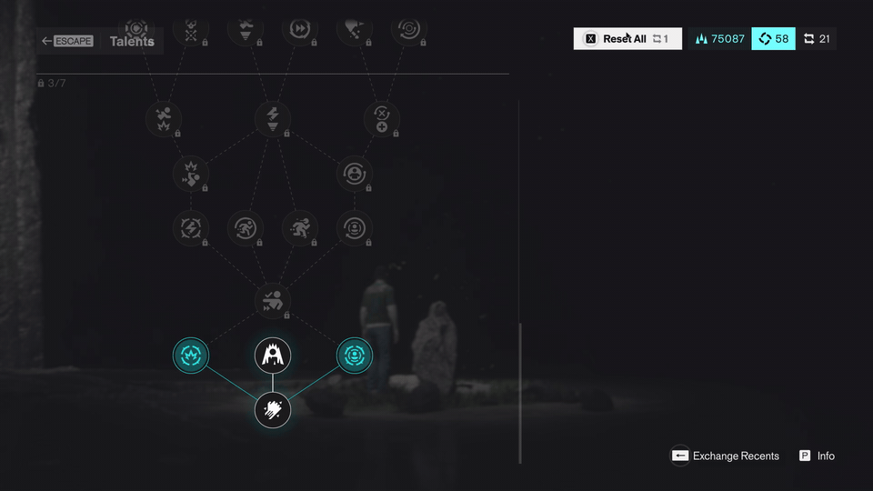

# CONTROL Resonant: Infinite Respec

Respec Talents, Aberrant Abilities and Combat Abilities as often as you like. You still need one
Respec Item in your inventory, but respeccing no longer uses it up.



Download from the [GitHub releases](../../releases) or [Nexus Mods](https://www.nexusmods.com/controlresonant/mods/194).

Tested on the Steam release, `CONTROLResonant.exe` 0.564.629.5, under Proton on Linux. Not yet tested on Windows itself.

## Install

1. Install the [f2g DLL Mod Loader for CONTROL Resonant](https://www.nexusmods.com/controlresonant/mods/9)
   (crloader). It loads every DLL in the game's `crmods\` folder.
2. Copy `ControlInfiniteRespec.dll` into `CONTROL Resonant\crmods\`.
3. Optional: copy `ControlInfiniteRespec.ini` next to it to change the mode.

On Linux or Steam Deck (Proton), crloader also needs this Steam launch option:

```
WINEDLLOVERRIDES="winmm=n,b" %command%
```

To uninstall, delete the DLL. The mod changes nothing on disk except its own log, and it never
touches your saves.

## What you'll see

`crmods\ControlInfiniteRespec.log` is rewritten at every launch. Its header describes your game
and setup, then each respec gets a line:

```
CONTROL Resonant Infinite Respec 1.3.0
Date: 2026-10-13 18:50
Game: CONTROLResonant.exe 0.564.629.5, PE timestamp 0x000000006ac4318a, image size 0x0000000006301000
Store: steam_api64.dll
System: Windows 10.0.19045, Wine 11.0 (Proton or Wine)
Other files in game folder: winmm.dll
Settings: no ControlInfiniteRespec.ini (defaults), mode=keep-one, log=1
...
ACTIVE - respecs no longer consume the Respec Item (you still need one).
Each respec is logged below with the item count before and after.

18:51:20 Talents screen: Respec Items owned=21
18:51:25 Talents respec: Respec Items before=21, removal requested=0, after=21  (kept)  [session: 1 respec, 0 items used]
```

The header also lists every place the game's code reads the Respec Item, with the surrounding
bytes. After a game update, that is enough to write new signatures from your log.

If a game update changes the code this mod looks for, the log says `FAIL` and **nothing is
patched**: the game runs unmodified, and it never ends up half-patched. If a respec ever does use
an item, its line ends in `** ITEM CONSUMED **`.

## Reporting a problem

[Open an issue](../../issues/new/choose) and paste the complete `ControlInfiniteRespec.log` and
`crloader.log`. The log contains no file paths or account names, so it is safe to share
unedited.

## Settings

`ControlInfiniteRespec.ini`, optional:

| Key | Values | Default |
|---|---|---|
| `mode` | `keep-one`: need one Respec Item, never lose it. `vanilla`: game unchanged, respecs are only logged. | `keep-one` |
| `log` | `1` logs each respec and the item count, `0` turns that off | `1` |

## How it works

The game removes a Respec Item through one inventory function, `RemoveItem(item, count, ...)`,
called from three places, one per respec screen. At each call site the code is:

```
mov  r9,  [reg+X]            ; arg 4
mov  edx, 1                  ; arg 2: count to remove   <- patched to 0
mov  r8,  [reg+Y]            ; arg 3
mov  ecx, [rip+disp]         ; arg 1: item hash 0x6EA9898D (CURRENCY_RESPEC_ITEMS)
mov  byte [rsp+20h], 1       ; arg 5
call RemoveItem
```

The mod changes `mov edx,1` (`BA 01 00 00 00`) to `mov edx,0`, so the game runs the respec but
doesn't remove anything. The separate "do you have at least one" check is a different function and is left
alone. The Combat Abilities screen also decrements a cached copy of the count right after the
call (`dec dword [rax+90h]`, shown as the second number in `1/1`). The mod replaces those 6 bytes
with NOPs.

| Screen | Pattern (`??` = any byte) | Change |
|---|---|---|
| Talents | `4C 8B 8B A8 00 00 00 BA 01 00 00 00 4C 8B 83 A0 00 00 00 8B 0D ?? ?? ?? ?? C6 44 24 20 01` | +8: `01` → `00` |
| Aberrant Abilities | `4C 8B 8F A0 00 00 00 BA 01 00 00 00 4C 8B 87 98 00 00 00 8B 0D ?? ?? ?? ?? C6 44 24 20 01` | +8: `01` → `00` |
| Combat Abilities | `4C 8B 8B 98 00 00 00 BA 01 00 00 00 4C 8B 83 90 00 00 00 8B 0D ?? ?? ?? ?? C6 44 24 20 01 E8 ?? ?? ?? ?? 48 8B 83 A0 00 00 00 FF 88 90 00 00 00` | +8: `01` → `00`, +42: 6× `90` |

The wildcards cover what moves between game builds: the address of the item constant and the call
target. Before writing anything the mod checks that each pattern matches exactly once and that each
site really loads the Respec Item hash. If any check fails, it doesn't write anything. After writing, it
reads each byte back.

For the log, each `call RemoveItem` goes through a small function that counts your Respec Items
before and after the original call. The count comes from the game's own `HasItem(item, n)` check,
called with growing `n` until it returns false. The respec screens' own `HasItem` calls for this
item are redirected the same way, so opening a screen logs the count. Their result is passed
through unchanged.

## Build

You need a MinGW-w64 GCC and `make`. The DLL has no C runtime and imports only KERNEL32.

| Platform | Install | Build |
|---|---|---|
| Windows | [MSYS2](https://www.msys2.org/), then in the UCRT64 shell: `pacman -S make mingw-w64-ucrt-x86_64-gcc` | `make CC=gcc` |
| Debian / Ubuntu | `sudo apt install mingw-w64 make` | `make` |
| Fedora | `sudo dnf install mingw64-gcc make` | `make` |
| Arch | `sudo pacman -S mingw-w64-gcc make` | `make` |

The output is `ControlInfiniteRespec.dll` in the repo folder.

A different GCC version produces a working DLL with a different hash. To reproduce the release DLL
byte for byte, build with the pinned toolchain in `flake.nix`:

```
nix build
sha256sum result/ControlInfiniteRespec.dll
```

## Credits

Based on the original Infinite Respec mod for CONTROL Resonant (Nexus Mods #49), which found the
three respec sites and the signature approach. This is a rewrite with source, validation, and
logging. Loading is handled by the f2g DLL Mod Loader for CONTROL Resonant (crloader).

## License

MIT, see [LICENSE](LICENSE).
